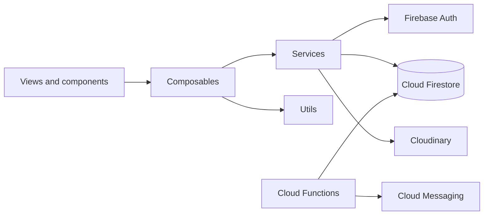
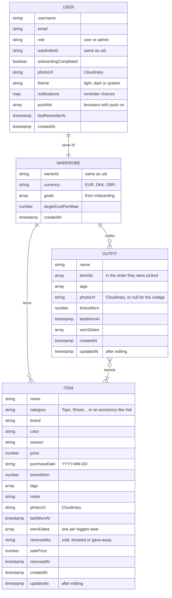

# wearit

wearit is a cost-per-wear wardrobe app. You add your clothes, log what you wear, and see each piece get cheaper the more you wear it.

Live at [wearit.site](https://wearit.site) (also [wearit-c77ac.web.app](https://wearit-c77ac.web.app)).

## Features

- **Wardrobe** – each item has a photo, brand, category, colour, season and tags. Accessories can be more specific (gloves, hat, cap, ring, necklace, earrings, bag). Switch between grid and list, search, and filter by cost per wear, category, brand, colour, season or tags.
- **Cost per wear** – price divided by wears, with progress towards a goal you set yourself.
- **Logging wears** – one tap, once a day per item (it resets at midnight). Every wear is kept in the item's history, and you see the new cost per wear straight away.
- **Outfits** – group two or more items and log them together. An outfit can have its own photo, otherwise it shows a collage of its items. Its cost per wear is the sum of its items'.
- **Insights** – spending, how cost per wear changes over time, categories, brands, which days you wear things, and your most worn outfits.
- **Selling, donating, giving away** – the item leaves the wardrobe but its history stays.
- **Push notifications** – reminders about clothes you haven't worn, a weekly summary, and a note when an item hits your goal.
- **Settings** – light, dark or system theme, and six currencies (EUR, DKK, GBP, USD, CZK, SEK).
- **Admin** – see all users, change roles, delete accounts.

Forms warn you before you leave with unsaved changes.

## Tech stack

| | |
|---|---|
| Frontend | Vue 3 (`<script setup>`), Vue Router, Vite, plain JavaScript |
| Backend | Firebase: Authentication (email and Google), Firestore, Cloud Functions, Cloud Messaging, Hosting |
| Photos | Cloudinary (unsigned uploads) |
| Charts | Chart.js with vue-chartjs |
| Linting and formatting | oxlint, ESLint, oxfmt |

## Getting started

You need Node.js 22.18+ or 24.12+. Deploying also needs the Firebase CLI.

```bash
git clone https://github.com/anetkabagetka/wearit.git
cd wearit
npm install
npm run dev
```

Before running it, add a `.env` file in the project root. The Firebase values are in the Firebase console under Project settings → Your apps, and the VAPID key under Cloud Messaging → Web Push certificates. The last two come from Cloudinary.

```env
VITE_FIREBASE_API_KEY=
VITE_FIREBASE_AUTH_DOMAIN=
VITE_FIREBASE_PROJECT_ID=
VITE_FIREBASE_STORAGE_BUCKET=
VITE_FIREBASE_MESSAGING_SENDER_ID=
VITE_FIREBASE_APP_ID=
VITE_FIREBASE_VAPID_KEY=
VITE_CLOUDINARY_CLOUD_NAME=
VITE_CLOUDINARY_UPLOAD_PRESET=
```

## Scripts

| Command | |
|---|---|
| `npm run dev` | Start the dev server |
| `npm run build` | Build into `dist/` |
| `npm run preview` | Serve the build locally |
| `npm run lint` | Lint and fix (oxlint and ESLint) |
| `npm run format` | Format `src/` with oxfmt |

## Project structure

```
wearit/
├── src/
│   ├── views/          pages: landing, auth/, user/ (items/, outfits/, settings/), admin/
│   ├── components/     layout/, ui/, items/, outfits/, landing/, plus dashboard/, wardrobe/ and insights/ for the bigger pages
│   ├── composables/    page state and actions: useWardrobe, items/, outfits/, settings/
│   ├── services/       the only code that calls Firestore or Cloudinary
│   ├── utils/          helpers: format/, forms/, wardrobe/, theme.js, charts.js
│   ├── router/         routes and access checks
│   ├── styles/         main.css, including the light and dark colours
│   ├── assets/         logo, icons, photos
│   └── firebase.js     Firebase setup, using the values from .env
├── functions/          Cloud Functions for push notifications
├── public/             favicon and the push notification service worker
├── firestore.rules     Firestore security rules
└── firebase.json       Firestore, Functions and Hosting config
```

## How it fits together

Views and components handle what you see, composables hold the state and actions, and services are the only place that talks to Firebase or Cloudinary.



The router checks each page before opening it. Guests are sent to log in, users who haven't finished onboarding are sent there, and only admins can open `/admin`.

## Pages

| Area | Pages |
|---|---|
| Public | Landing, About us, Contact & support |
| Account | Log in, Sign up with 4-step onboarding, Reset password |
| App | Home, Wardrobe (items and outfits), Item, Add/edit item, Outfit, Create/edit outfit, Insights |
| Settings | Settings, Edit profile, Change password, Currency, Notifications, Theme, Delete account |
| Admin | Users |

## Database

Firestore. Each user has a profile and a wardrobe with the same ID, and their items and outfits live inside the wardrobe.

```
users/{uid}                  profile and settings
wardrobes/{uid}              currency and goal
├── items/{itemId}           clothes
└── outfits/{outfitId}       outfits, pointing to their items by ID
```



A few things worth knowing:

- Cost per wear isn't stored. It's calculated from `price` and `timesWorn`, and for outfits by adding up the items.
- Logging a wear adds 1 to `timesWorn`, sets `lastWornAt` and adds the date to `wornDates`. Logging an outfit does this for the outfit and all its items in one batch, skipping items already worn that day.
- Outfits only store item IDs, so they always use the items' current numbers. Sold, donated or deleted items drop out.
- Accessory kinds like Hat or Bag are saved as the `category`. Filters, Insights and the outfit picker group them under Accessories.
- Sold, donated and given-away items aren't deleted, they get a `removedAs` field so their history is kept.
- Deleting an account removes the profile, wardrobe, items and outfits in one batch.
- Photos live in Cloudinary (`wearit/profile-pictures/{uid}`, `wearit/wardrobes/{uid}/items`, `wearit/wardrobes/{uid}/outfits`). Firestore only stores the URL.

## Security rules

- Users can only read and change their own profile, wardrobe, items and outfits.
- New profiles always start with the `"user"` role, and users can't change their own role.
- Admins can read all profiles and wardrobes, change roles and delete users.

## Cloud Functions

| Function | Runs | Sends |
|---|---|---|
| `dailyReminders` | Every day at 09:00 (Copenhagen time) | A reminder about clothes you haven't worn in a while |
| `weeklySummary` | Mondays at 08:00 | Last week's wears and your average cost per wear |
| `goalMilestone` | When an item is saved | A message when an item reaches your cost-per-wear goal |

Notifications only go to users who turned them on in Settings → Notifications.

## Deploying

```bash
npm run build
firebase deploy --only hosting
```

Rules and functions are deployed separately with `firebase deploy --only firestore:rules` and `firebase deploy --only functions`.

## Author

Made by [anetkabagetka](https://github.com/anetkabagetka).
