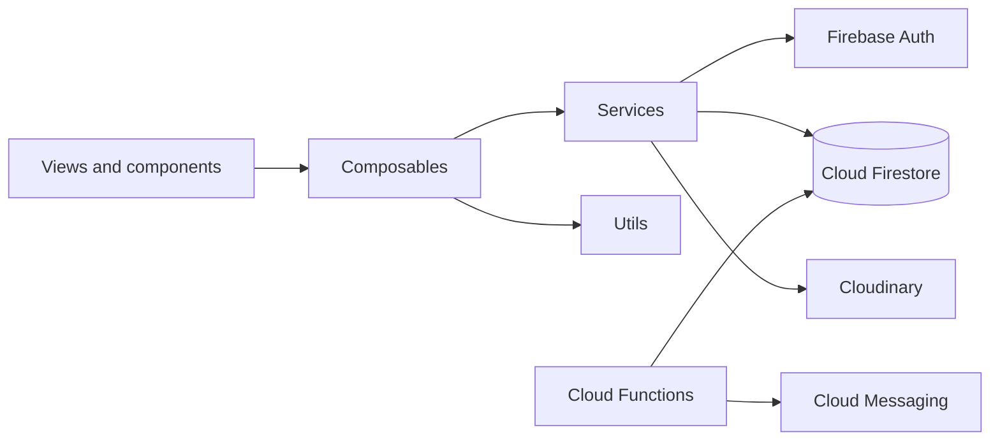
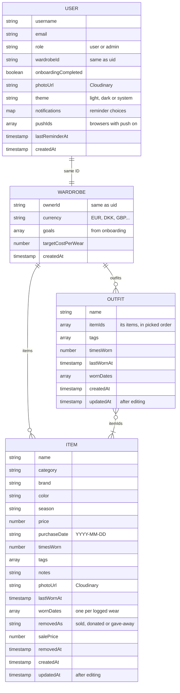

# 👗 wearit

**Know what every outfit really costs.** wearit is a cost-per-wear wardrobe app: add your clothes, log what you wear, and watch each piece get cheaper with every wear.

🔗 **Live:** [wearit-c77ac.web.app](https://wearit-c77ac.web.app)

## ✨ Features

- **Wardrobe:** clothes with photo, brand, category, color, season and tags. Grid or list, search and filters.
- **Cost per wear:** price ÷ wears for every item, with progress towards your own goal.
- **Log a wear:** one tap, once a day per item, with a full wear history.
- **Outfits:** put 2 or more items together and log them all at once. An outfit's cost per wear is its items' added up.
- **Insights:** spending, the cost-per-wear trend, categories, brands, when you wear clothes, and your most worn outfits.
- **Sold, donated or given away:** the item leaves the wardrobe but keeps its history.
- **Push notifications:** reminders for clothes you don't wear, a weekly summary, and goal milestones.
- **Your way:** light or dark theme, and 6 currencies (EUR, DKK, GBP, USD, CZK, SEK).
- **Admin:** see all users, change roles, delete accounts.

## 🧰 Tech stack

| | |
|---|---|
| **Frontend** | Vue 3 (`<script setup>`), Vue Router, Vite, plain JavaScript |
| **Backend** | Firebase: Authentication (email + Google), Cloud Firestore, Cloud Functions, Cloud Messaging, Hosting |
| **Photos** | Cloudinary (unsigned uploads) |
| **Charts** | Chart.js + vue-chartjs |
| **Code quality** | oxlint + ESLint, oxfmt |

## 🚀 Getting started

You need Node.js 22.18+ (or 24.12+), and the Firebase CLI to deploy.

```bash
git clone https://github.com/anetkabagetka/wearit.git
cd wearit
npm install
npm run dev
```

Create a `.env` file in the project root first. The values come from the Firebase console (Project settings → Your apps, and Cloud Messaging → Web Push certificates for the VAPID key) and from Cloudinary:

```env
VITE_FIREBASE_API_KEY=
VITE_FIREBASE_AUTH_DOMAIN=
VITE_FIREBASE_PROJECT_ID=
VITE_FIREBASE_STORAGE_BUCKET=
VITE_FIREBASE_MESSAGING_SENDER_ID=
VITE_FIREBASE_APP_ID=
VITE_FIREBASE_VAPID_KEY=
VITE_CLOUDINARY_CLOUD_NAME=
VITE_CLOUDINARY_UPLOAD_PRESET=
```

## 📜 Scripts

| Command | What it does |
|---|---|
| `npm run dev` | Starts the dev server |
| `npm run build` | Builds the website into `dist/` |
| `npm run preview` | Serves the built website locally |
| `npm run lint` | Checks and fixes the code (oxlint + ESLint) |
| `npm run format` | Formats `src/` with oxfmt |

## 🗂️ Project structure

```
wearit/
├── src/
│   ├── views/          pages: landing, auth/, user/ (items/, outfits/, settings/), admin/
│   ├── components/     shared UI: layout/, ui/, items/, outfits/, landing/
│   ├── composables/    each page's state and actions: useWardrobe, items/, outfits/, settings/
│   ├── services/       Firestore and Cloudinary calls only: wardrobes, outfits, users…
│   ├── utils/          small helpers: format/, forms/, wardrobe/, theme.js
│   ├── router/         the routes and who can open them
│   ├── styles/         main.css with the light and dark colours
│   ├── assets/         logo, icons, landing photos
│   └── firebase.js     connects to Firebase with the values from .env
├── functions/          Cloud Functions for the push notifications
├── public/             favicon and the push notification service worker
├── firestore.rules     who may read and change what
└── firebase.json       Firestore, Functions and Hosting setup
```

## 🏗️ Architecture

Each layer has one job: **views** show things, **composables** hold the state and actions, **services** are the only code that talks to Firebase or Cloudinary.



The router checks every page before it opens: guests go to login, users who haven't finished onboarding go to onboarding, and only admins can open `/admin`.

## 🧭 Pages

| Area | Pages |
|---|---|
| **Public** | Landing, About us, Contact & support |
| **Account** | Log in, Sign up and onboarding (4 steps), Reset password |
| **App** | Home, Wardrobe (Items and Outfits), Item, Add / edit item, Outfit, Create / edit outfit, Insights |
| **Settings** | Profile, Edit profile, Change password, Currency, Notifications, Theme, Delete account |
| **Admin** | Users |

## 🗄️ Database

Cloud Firestore. Every user has one profile and one wardrobe with the same ID; their clothes and outfits live inside the wardrobe.

```
users/{uid}                  profile and settings
wardrobes/{uid}              currency and goal, same ID as the user
├── items/{itemId}           the clothes
└── outfits/{outfitId}       groups of items, linked by itemIds
```



- **Cost per wear** is never saved: it's worked out from `price` and `timesWorn` (an outfit: its items' costs added up).
- **A wear** adds 1 to `timesWorn`, sets `lastWornAt` and adds the date to `wornDates`. Logging an outfit does that for the outfit and its items in one batch, skipping items already worn today.
- **Outfits only store item IDs**, so an outfit always uses its items' latest numbers. Sold, donated or deleted items drop out of it.
- **Sold, donated or given away** items stay saved with `removedAs`, so their history and final cost per wear are kept.
- **Deleting an account** removes the profile, wardrobe, items and outfits in one batch.
- **Photos** are in Cloudinary (`wearit/profile-pictures/{uid}` and `wearit/wardrobes/{uid}/items`); Firestore only keeps their `photoUrl`.

## 🔐 Security rules

- Everyone can only read and change their own profile, wardrobe, items and outfits.
- A new profile always starts as `"user"`, and users can't change their own role.
- Admins can read all profiles and wardrobes, change roles, and delete users.

## 🔔 Cloud Functions

| Function | When | What it sends |
|---|---|---|
| `dailyReminders` | Every day, 09:00 (Copenhagen) | A reminder about clothes not worn for a while |
| `weeklySummary` | Mondays, 08:00 | Last week's wears and the average cost per wear |
| `goalMilestone` | When an item is saved | A cheer when an item reaches the cost-per-wear goal |

Each one only goes to users who turned it on in Settings → Notifications.

## ☁️ Deploy

```bash
npm run build
firebase deploy --only hosting
```

Rules and functions deploy separately with `firebase deploy --only firestore:rules` and `firebase deploy --only functions`.

## 👩‍💻 Author

Made by [anetkabagetka](https://github.com/anetkabagetka).